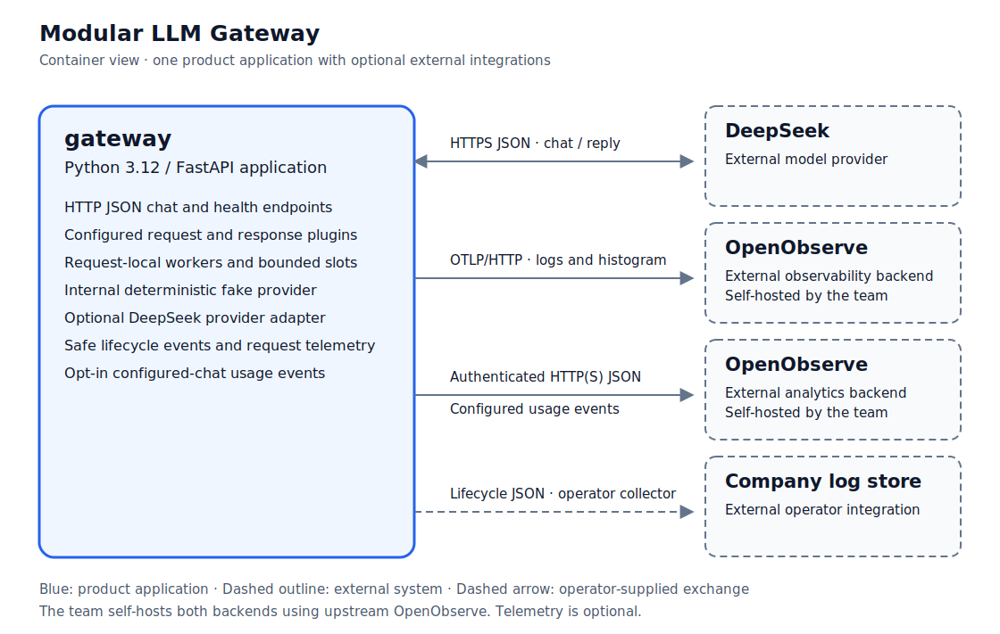

# Architecture

This document records the gateway architecture serving the scope in the [product vision](../product-vision.md).

## Drivers

- **Business goals:** [the threshold of success](../threshold-of-success.md).
- **Constraints:** the product vision's [constraints](../product-vision.md#constraints).
- **Functional requirements:** the [functional requirements index](../functional-requirements/README.md).
- **Quality requirements:** the [quality requirements index and priority matrix](../quality-requirements/README.md).

## Container View

The product runs as one application container, `gateway`, and [ADR-001](adr/ADR-001.md) records its stack and split. [ADR-007](adr/ADR-007.md) and [ADR-008](adr/ADR-008.md) record the analytics and observability interfaces.

The gateway is the deployed product. The fake provider runs internally, and the DeepSeek adapter uses HTTPS when enabled. The team self-hosts both OpenObserve backends and builds the gateway. The gateway can serve with telemetry off. Company collection of the local lifecycle events remains operator supplied.

The execution boundary in [ADR-003](adr/ADR-003.md) uses disposable internal worker processes within the same deployed application.
Each request owns its worker and its plugin instances; those instances are shared across that request's request and response stages and discarded before the next request.
The execution deadline covers hooks in those workers; initial application-factory import and constructor validation remains trusted startup work outside that deadline.

### Container Responsibilities

| Container | Responsibilities |
| --- | --- |
| `gateway` | Validate incoming chat requests and the selected plugin configuration; run the configured request and response hooks in order around provider forwarding; own request-local payloads, plugin instances and bounded execution slots in memory; return replies or named failures and export safe operating signals. |

The application owns no durable user-data store.
Its JSON configuration is operator-managed input. Local lifecycle events leave through the configured logging handlers or stderr. The optional OpenObserve exporters send usage events to the analytics backend and request outcomes and latency to the observability backend. Each backend owns retention, access control and durable storage.

The future delivery target in [ADR-005](adr/ADR-005.md) packages this same application for an operator-provided host; [ADR-006](adr/ADR-006.md) keeps future aggregate metrics inside its parent process.
Neither adds a product application or data store, and neither capability is implemented by this architecture document.

## Diagrams And Legends

- **Blue rounded rectangle:** the product's single deployable application container; the label gives its name and technology.
- **Gray dashed rectangle:** an external system outside the product boundary. The team self-hosts the two OpenObserve instances using the upstream software.
- **Solid arrow:** an implemented interface. Its label states the data and protocol.
- **Dashed arrow:** an operator-supplied integration.
- **Boundary annotations:** the application accepts HTTP JSON chat and health requests, writes JSON diagnostic events to stderr or logging handlers, and can use an internal fake provider.
- **Tool and source:** [container.svg](container.svg) is editable SVG source; [container.png](container.png) is rendered from that source with CairoSVG. Edit and render them together. The system context and actors remain in the vision's existing diagram.

## Architectural Decisions

| ADR | Status | Addresses | Decision |
| --- | --- | --- | --- |
| [ADR-001](adr/ADR-001.md) | Accepted | [FR-004](../functional-requirements/fr/FR-004.md), [QR-01](../quality-requirements/qr/QR-01.md), [QR-04](../quality-requirements/qr/QR-04.md) | One Python gateway application with an internal fake provider |
| [ADR-002](adr/ADR-002.md) | Accepted | [FR-001](../functional-requirements/fr/FR-001.md), [FR-002](../functional-requirements/fr/FR-002.md), [FR-003](../functional-requirements/fr/FR-003.md), [FR-005](../functional-requirements/fr/FR-005.md), [QR-01](../quality-requirements/qr/QR-01.md), [QR-04](../quality-requirements/qr/QR-04.md) | Explicit import-path configuration and ordered dictionary hooks |
| [ADR-003](adr/ADR-003.md) | Accepted | [FR-006](../functional-requirements/fr/FR-006.md), [FR-007](../functional-requirements/fr/FR-007.md), [QR-01](../quality-requirements/qr/QR-01.md), [QR-02](../quality-requirements/qr/QR-02.md), [QR-05](../quality-requirements/qr/QR-05.md) | Request-local supervised workers and fail-request timeouts |
| [ADR-004](adr/ADR-004.md) | Accepted | [FR-008](../functional-requirements/fr/FR-008.md), [QR-01](../quality-requirements/qr/QR-01.md), [QR-03](../quality-requirements/qr/QR-03.md) | Parent-generated allowlisted lifecycle events |
| [ADR-005](adr/ADR-005.md) | Accepted | [FR-009](../functional-requirements/fr/FR-009.md), [FR-010](../functional-requirements/fr/FR-010.md), [QR-01](../quality-requirements/qr/QR-01.md), [QR-03](../quality-requirements/qr/QR-03.md), [QR-06](../quality-requirements/qr/QR-06.md) | Identified image delivery and retained known-good recovery on an operator-provided host |
| [ADR-006](adr/ADR-006.md) | Accepted | [FR-008](../functional-requirements/fr/FR-008.md), [FR-011](../functional-requirements/fr/FR-011.md), [QR-01](../quality-requirements/qr/QR-01.md), [QR-03](../quality-requirements/qr/QR-03.md), [QR-07](../quality-requirements/qr/QR-07.md) | Bounded process-local aggregate metrics using the existing safe event contract |
| [ADR-007](adr/ADR-007.md) | Accepted | [FR-012](../functional-requirements/fr/FR-012.md), [QR-03](../quality-requirements/qr/QR-03.md) | Record gateway usage in a dedicated analytics backend |
| [ADR-008](adr/ADR-008.md) | Accepted | [FR-013](../functional-requirements/fr/FR-013.md), [QR-08](../quality-requirements/qr/QR-08.md), [QR-03](../quality-requirements/qr/QR-03.md) | Export request outcomes to OpenObserve |
