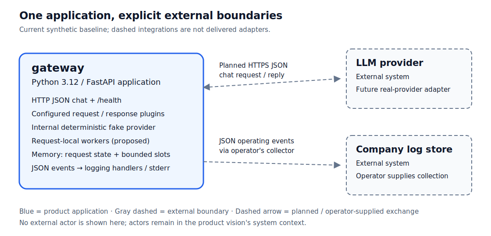

# Architecture

This document records the gateway architecture serving the scope in the [product vision](../product-vision.md).

## Drivers

- **Business goals:** [the threshold of success](../threshold-of-success.md).
- **Constraints:** the product vision's [constraints](../product-vision.md#constraints).
- **Functional requirements:** the [functional requirements index](../functional-requirements/README.md).
- **Quality requirements:** the [quality requirements index and priority matrix](../quality-requirements/README.md).

## Container View

The current product genuinely runs as one application container, `gateway`, and [ADR-001](adr/ADR-001.md) records its stack and split.

The blue application is the deployed product; its fake provider is internal and needs no external key or service.
The dashed external systems preserve the vision's integration boundaries: a real provider adapter is not implemented, and company log collection is operator supplied rather than a bundled store.
Solid HTTP request handling and local diagnostic output are implemented; the diagram's dashed exchanges are integration targets, not a claim that the gateway already calls a real provider or writes to a company store.

The baseline runs hooks in the application process.
The proposed execution decision in [ADR-003](adr/ADR-003.md) adds disposable internal worker processes to the same deployed application; it adds no separately deployed service or database.
Each request owns its worker and its plugin instances; those instances are shared across that request's request and response stages and discarded before the next request.
The execution deadline covers hooks in those workers; initial application-factory import and constructor validation remains trusted startup work outside that deadline.

### Container Responsibilities

| Container | Responsibilities |
| --- | --- |
| `gateway` | Validate incoming chat requests and the selected plugin configuration; run the configured request and response hooks in order around provider forwarding; own request-local payloads, plugin instances and bounded execution slots in memory; return replies or named failures and emit safe operating events. |

The application owns no durable user-data store.
Its JSON configuration is operator-managed input, and its operating events leave through the configured logging handlers or stderr.
A company store owns retention, access control and durable storage when the operator connects one.
Provider credentials and real-provider data are absent from the synthetic baseline.

## Diagrams And Legends

- **Blue rounded rectangle:** the product's single deployable application container; the label gives its name and technology.
- **Gray dashed rectangle:** an external system from the vision, outside the product and not supplied by the baseline.
- **Dashed arrow:** a planned or operator-supplied integration; its label states the data and protocol boundary.
- **Boundary annotations:** the application accepts HTTP JSON chat and health requests, writes JSON diagnostic events to stderr or logging handlers, and uses an internal fake provider in the baseline. These annotations are interfaces, not extra containers or external actors.
- **Tool and source:** [container.svg](container.svg) is editable SVG source; [container.png](container.png) is rendered from that source with CairoSVG. Edit and render them together. The system context and actors remain in the vision's existing diagram.

## Architectural Decisions

| ADR | Status | Addresses | Decision |
| --- | --- | --- | --- |
| [ADR-001](adr/ADR-001.md) | Accepted | [FR-004](../functional-requirements/fr/FR-004.md), [QR-01](../quality-requirements/qr/QR-01.md), [QR-04](../quality-requirements/qr/QR-04.md) | One Python gateway application with an internal fake provider |
| [ADR-002](adr/ADR-002.md) | Accepted | [FR-001](../functional-requirements/fr/FR-001.md), [FR-002](../functional-requirements/fr/FR-002.md), [FR-003](../functional-requirements/fr/FR-003.md), [FR-005](../functional-requirements/fr/FR-005.md), [QR-01](../quality-requirements/qr/QR-01.md), [QR-04](../quality-requirements/qr/QR-04.md) | Explicit import-path configuration and ordered dictionary hooks |
| [ADR-003](adr/ADR-003.md) | Proposed | [FR-006](../functional-requirements/fr/FR-006.md), [FR-007](../functional-requirements/fr/FR-007.md), [QR-01](../quality-requirements/qr/QR-01.md), [QR-02](../quality-requirements/qr/QR-02.md) | Request-local supervised workers and fail-request timeouts |
| [ADR-004](adr/ADR-004.md) | Proposed | [FR-008](../functional-requirements/fr/FR-008.md), [QR-01](../quality-requirements/qr/QR-01.md), [QR-03](../quality-requirements/qr/QR-03.md) | Parent-generated allowlisted lifecycle events |
