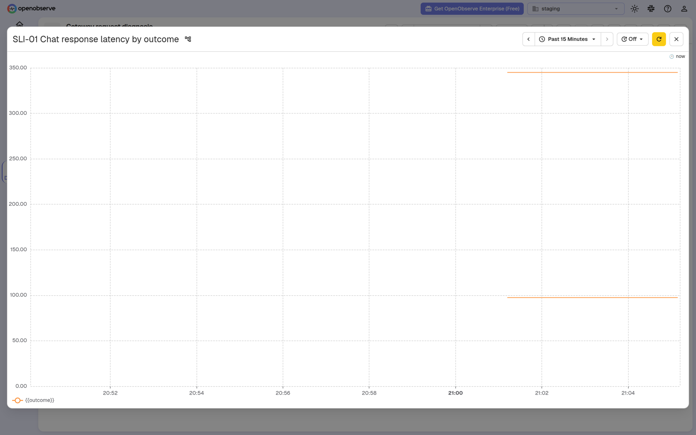
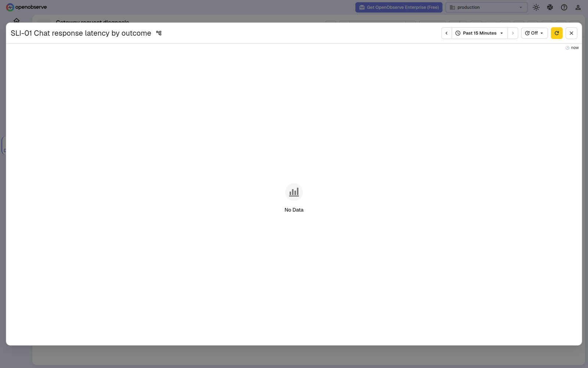

# Week 06 report

## Project

Modular LLM Gateway, team 9, Assignment 6: product analytics, observability and the Week 6 release.

## Summary

SPRINT-06 set out to make the gateway's use and operation visible: privacy-safe analytics events for a product analyst ([US-11](https://github.com/ITPD-Almo/modular-llm-gateway/issues/110)) and the operating signals an operator uses to diagnose a failed request ([US-12](https://github.com/ITPD-Almo/modular-llm-gateway/issues/111)), in four dashboards on the university network.
The sprint was planned, and its task issues opened, only on 2026-11-08, its due date; the [plan](../../docs/project-plan.md#sprint-06) records it.

The telemetry work started on the due date, and this report separates what is running on the university VM, what is merged and what was verified from campus.
Both telemetry backends run privately on the temporary university VM: an OpenObserve instance for observability with `staging` and `production` organizations and the `SLI-01` dashboard in each, and a separate OpenObserve instance for analytics with its two dashboards.
The observability pipeline ([#108](https://github.com/ITPD-Almo/modular-llm-gateway/issues/108), [PR #109](https://github.com/ITPD-Almo/modular-llm-gateway/pull/109)) adds the [observability plan](../../docs/observability.md), `SLI-01` and the diagnosability requirement QR-08; it was merged on 2026-11-08 as `95c39fc`.
The analytics pipeline ([#112](https://github.com/ITPD-Almo/modular-llm-gateway/issues/112)) was merged on 2026-11-08 as `a4c547a` from [PR #121](https://github.com/ITPD-Almo/modular-llm-gateway/pull/121), built on Ali12hamdan's handoff draft [PR #120](https://github.com/ITPD-Almo/modular-llm-gateway/pull/120); it adds the [analytics plan](../../docs/analytics.md), its event table, FR-012 and ADR-007.
The focus metric has no value: the VM loopback smoke of the analytics draft recorded staging smoke events but no eligible staging attempt, and production stored no events; a value needs people outside the team using the gateway in the Week 7 usability test.
QR-08 QRT-01 passed from a campus client against staging at the merged pull request's head, `1b537db`, and both observability dashboards were captured from campus; the analytics dashboards were not checked from campus. The result is in the [testing plan](../../docs/project-plan.md#quality-requirement-testing-plan) and [below](#qr-08-qrt-01-campus-run).

The Customer review was held on 2026-11-07, before the telemetry existed.
It showed the one-command install and a request to a real model, and it settled three decisions: a Docker Compose deployment ([DEC-012](../../docs/decisions.md#dec-012)), the terminal as the interface ([DEC-013](../../docs/decisions.md#dec-013)) and Saturday reviews with asynchronous questions ([DEC-014](../../docs/decisions.md#dec-014)).
No story was walked through its criteria and no verdict was given, so Actual Velocity is 0, and US-01 to US-04, US-09, US-11 and US-12 (24 points) carry over to SPRINT-07 when the SPRINT-06 milestone closes.

`REL-06` is not cut at the time of writing; the [deviations](#deviations) say why, and the [REL-06 block](../../docs/project-plan.md#rel-06) is filled when it is.

## Minimum usable product and Customer outcome

The candidate remains [US-01](https://github.com/ITPD-Almo/modular-llm-gateway/issues/40), [US-02](https://github.com/ITPD-Almo/modular-llm-gateway/issues/41) and [US-03](https://github.com/ITPD-Almo/modular-llm-gateway/issues/42).
At the [2026-11-07 review](meeting-report.md) the Customer saw the install and the guided provider setup from [US-09](https://github.com/ITPD-Almo/modular-llm-gateway/issues/96) and the plugin configuration and hook code behind US-01 to US-04, but no story was shown criterion by criterion and none was accepted or rejected, so no verdict `DEC-nnn` exists.
All scheduled stories carry over to SPRINT-07 rather than being dropped; at the time of writing they are still in the SPRINT-06 milestone, and their move is recorded when it happens.

## Dashboards and the observability test

What is running, what is merged and what was verified are three different states, kept apart here.

| Item | Running on the VM | Merged | Verified from campus |
| --- | --- | --- | --- |
| Observability backend, `staging` and `production` organizations, `SLI-01` dashboard in each ([#115](https://github.com/ITPD-Almo/modular-llm-gateway/issues/115), [#116](https://github.com/ITPD-Almo/modular-llm-gateway/issues/116)) | Yes | Yes: [PR #109](https://github.com/ITPD-Almo/modular-llm-gateway/pull/109), with the dashboard definition | Yes: both dashboards opened from campus on 2026-11-08, [screenshots below](#qr-08-qrt-01-campus-run) |
| QR-08 QRT-01 | A VM loopback rehearsal at commit `be5e8ce` returned the named 504, the matching timeout log in 0.426 s and a numeric P95 in 1.464 s. Staging now runs the #109 head, `1b537db`, where two VM-side HTTPS runs passed, the second an immediate rerun with the matching log in 0.432 s and a numeric P95 in 1.290 s. Production received no test data | Yes: [PR #109](https://github.com/ITPD-Almo/modular-llm-gateway/pull/109), with the checker | Yes: passed on 2026-11-08 at `1b537db`, [#117](https://github.com/ITPD-Almo/modular-llm-gateway/issues/117) |
| Analytics backend and its two dashboards ([#113](https://github.com/ITPD-Almo/modular-llm-gateway/issues/113), [#114](https://github.com/ITPD-Almo/modular-llm-gateway/issues/114)) | Yes | Yes: [PR #121](https://github.com/ITPD-Almo/modular-llm-gateway/pull/121), with both dashboard definitions | No: not checked from campus before the deadline |
| Analytics smoke | A VM loopback smoke produced staging events, with no eligible staging attempt and no production event | No | No: pending |

A loopback rehearsal runs on the VM itself and is not the assessed result: QR-08 QRT-01 counts only when it is run from a machine on the university network against the staging deployment.

### QR-08 QRT-01 campus run

Mohammed-Nour ran [QR-08 QRT-01](../../docs/quality-requirements/qr/QR-08.md#qrt-01) on 2026-11-08 at 21:01 Moscow time from a laptop on the university Wi-Fi, with the route to the VM checked to leave through the campus interface rather than a VPN.
The checker came from commit `1b537dbc03f399868c7b0daf37c8231969491106`, the head of [PR #109](https://github.com/ITPD-Almo/modular-llm-gateway/pull/109), which was the commit running on staging; the private settings stayed on the runner and only the sanitized result was kept.

| Check | Limit | Result |
| --- | --- | --- |
| The deliberately failing chat returns the named error with a request ID | HTTP 504 | HTTP 504, request ID `bc4c6b0c8e5543e8a1a791824c3582ad` |
| Exactly one matching staging log point, with route, outcome and environment | 5 s | Found in 1.811 s: route `/v1/chat/completions`, outcome `timeout`, duration 322 ms, environment `staging` |
| `SLI-01` returns a finite P95 for a new timeout observation | 60 s | 345 ms for the `timeout` series, returned in 1.846 s |

The test passes. Restoring staging's normal provider and plugin settings, the procedure's last step, was handed to Ali12hamdan, who operates the VM.

The **Gateway request diagnosis** dashboard's `SLI-01 Chat response latency by outcome` chart, opened from campus in each organization over the 15 minutes after the run:

Staging shows two series: the timeout series at 345 ms, matching the query result above, and the healthy chats near 97 ms.
Both series carry the literal legend `{{outcome}}` instead of the outcome value, so the chart does not name them; this is a defect in the dashboard definition, recorded in the [deviations](#deviations).
Production shows no data: no test traffic reached it.

## Threshold review

| Goal | Current measure | New data can settle it | Proposal |
| --- | --- | --- | --- |
| [TOS-01](../../docs/threshold-of-success.md#tos-01) | An accepted verdict, as a `DEC-nnn`, on every candidate story of MLS-03, by the end of Week 4, 2026-10-23. | No: it is settled by a Customer verdict, not by telemetry. | — |
| [TOS-02](../../docs/threshold-of-success.md#tos-02) | One usability-test session in which a participant outside the team follows `docs/setup.md`, sends a request through two plugins and sees the result without help, by the end of Week 7, 2026-11-13. | No: it is settled by an observed session; analytics events could count the steps, but no analytics pipeline is deployed. | — |
| [TOS-03](../../docs/threshold-of-success.md#tos-03) | One plugin, written by a developer outside the team against `docs/plugins.md`, that loads from the configuration file and changes a request, with no commit to the core, by the end of Week 7, 2026-11-13. | No: it is settled by an outside developer's plugin and the repository history, which no signal records. | — |
| [TOS-04](../../docs/threshold-of-success.md#tos-04) | A request to the deployed gateway passes through two plugins and returns the fake provider's response, shown in the release notes of `REL-05`, by the end of Week 5, 2026-10-30. | No: its date had passed before the review; the observability data could show such a request, but not by that date. | — |

[TOS-01](../../docs/threshold-of-success.md#tos-01) is `Missed`.
[TOS-02](../../docs/threshold-of-success.md#tos-02) stays `Open`.
[TOS-03](../../docs/threshold-of-success.md#tos-03) stays `Open`.
[TOS-04](../../docs/threshold-of-success.md#tos-04) is `Missed`.

The team proposed no measure: the [analytics plan](../../docs/analytics.md) merged on the due date and its focus metric has no observation yet, so a measure built on it would have no baseline; the two open goals already measure what the Customer cares about, outside people using the product, in Week 7. No proposal was presented at the 2026-11-07 review, so there is no Customer decision on one and no goal changed.

## Coverage

| Deliverable | Artifact |
| --- | --- |
| Sprint plan and new stories | [docs/project-plan.md#sprint-06](../../docs/project-plan.md#sprint-06), and [US-11](https://github.com/ITPD-Almo/modular-llm-gateway/issues/110) and [US-12](https://github.com/ITPD-Almo/modular-llm-gateway/issues/111) in the [SPRINT-06 milestone](https://github.com/ITPD-Almo/modular-llm-gateway/milestone/4) |
| Analytics plan | [docs/analytics.md](../../docs/analytics.md) |
| Events and instrumentation | [docs/analytics.md#the-events](../../docs/analytics.md#the-events) and the exporter in `gateway/analytics.py` |
| Analytics dashboards | Running on the VM and not yet checked from campus, so there are no screenshots; see [Dashboards and the observability test](#dashboards-and-the-observability-test) |
| Observability plan and `SLI`s | [docs/observability.md](../../docs/observability.md) |
| Observability dashboards | [images/observability-staging.png](images/observability-staging.png) and [images/observability-production.png](images/observability-production.png), from the [campus run](#qr-08-qrt-01-campus-run) |
| Feature documentation | [docs/features.md](../../docs/features.md) |
| Functional requirements | [docs/functional-requirements/README.md](../../docs/functional-requirements/README.md), with FR-013 from [PR #109](https://github.com/ITPD-Almo/modular-llm-gateway/pull/109) and FR-012 from [PR #121](https://github.com/ITPD-Almo/modular-llm-gateway/pull/121) |
| ADRs and container view | [docs/architecture/README.md#architectural-decisions](../../docs/architecture/README.md#architectural-decisions) and [docs/architecture/README.md#container-view](../../docs/architecture/README.md#container-view), with ADR-008 from [PR #109](https://github.com/ITPD-Almo/modular-llm-gateway/pull/109) and ADR-007 from [PR #121](https://github.com/ITPD-Almo/modular-llm-gateway/pull/121) |
| Observability requirement | [docs/quality-requirements/qr/QR-08.md](../../docs/quality-requirements/qr/QR-08.md) and its [QRT-01](../../docs/quality-requirements/qr/QR-08.md#qrt-01), passed from campus: [QR-08 QRT-01 campus run](#qr-08-qrt-01-campus-run) |
| Runtime test re-run | None: no runtime test was re-run this sprint |
| Threshold review | [reports/week-06/README.md#threshold-review](#threshold-review) |
| Week 5 action points | [`## Previous action points` in reports/week-06/meeting-report.md](meeting-report.md#previous-action-points): Week 5 had no meeting report, so these are the Week 4 action points it carried |
| Week 5 open questions | [`## Previous open questions` in reports/week-06/meeting-report.md](meeting-report.md#previous-open-questions) |
| Meeting script | [reports/week-06/meeting-script.md](meeting-script.md): a reconstructed agenda and a follow-up agenda, written after the meeting |
| Meeting transcript | None: the permission questions were not asked, so the transcript is neither published nor shared; see the [meeting report](meeting-report.md#metadata) |
| Customer validation | [reports/week-06/meeting-report.md](meeting-report.md); no threshold proposal was presented, so there is no threshold decision |
| `REL-06` | [docs/project-plan.md#rel-06](../../docs/project-plan.md#rel-06) |
| Sprint retrospective | [reports/week-06/sprint-retrospective.md](sprint-retrospective.md) |
| AI usage | [reports/week-06/ai-usage.md](ai-usage.md) |

## Contribution

| Member | Evidenced work |
| --- | --- |
| Ali12hamdan | Responsible for [#108](https://github.com/ITPD-Almo/modular-llm-gateway/issues/108), [US-12 #111](https://github.com/ITPD-Almo/modular-llm-gateway/issues/111), [#115](https://github.com/ITPD-Almo/modular-llm-gateway/issues/115) and [#116](https://github.com/ITPD-Almo/modular-llm-gateway/issues/116). Presented at the [2026-11-07 Customer review](meeting-report.md); opened [PR #109](https://github.com/ITPD-Almo/modular-llm-gateway/pull/109) with the OTLP exporter, `SLI-01`, QR-08, FR-013, ADR-008 and the QRT checker; deployed both telemetry backends on the university VM and ran the loopback rehearsals; prepared the analytics handoff draft [PR #120](https://github.com/ITPD-Almo/modular-llm-gateway/pull/120). |
| Mohammed-Nour | Responsible for [#117](https://github.com/ITPD-Almo/modular-llm-gateway/issues/117) and Accountable for [#108](https://github.com/ITPD-Almo/modular-llm-gateway/issues/108) and [#112](https://github.com/ITPD-Almo/modular-llm-gateway/issues/112) to [#116](https://github.com/ITPD-Almo/modular-llm-gateway/issues/116). Planned SPRINT-06 and refined the backlog: [US-11](https://github.com/ITPD-Almo/modular-llm-gateway/issues/110), [US-12](https://github.com/ITPD-Almo/modular-llm-gateway/issues/111), [US-13](https://github.com/ITPD-Almo/modular-llm-gateway/issues/118), tasks [#112](https://github.com/ITPD-Almo/modular-llm-gateway/issues/112) to [#117](https://github.com/ITPD-Almo/modular-llm-gateway/issues/117) and the notes on #65, #67, #68 and #97; reviewed [PR #109](https://github.com/ITPD-Almo/modular-llm-gateway/pull/109) and [PR #121](https://github.com/ITPD-Almo/modular-llm-gateway/pull/121); ran QR-08 QRT-01 from campus and captured both observability dashboards; wrote the Week 6 meeting artifacts, DEC-012 to DEC-014, the threshold review, the retrospective and this report. |
| atkond2point0 | Responsible for [US-11 #110](https://github.com/ITPD-Almo/modular-llm-gateway/issues/110), [#112](https://github.com/ITPD-Almo/modular-llm-gateway/issues/112), [#113](https://github.com/ITPD-Almo/modular-llm-gateway/issues/113) and [#114](https://github.com/ITPD-Almo/modular-llm-gateway/issues/114); opened the analytics delivery pull request [PR #121](https://github.com/ITPD-Almo/modular-llm-gateway/pull/121), which carries Ali12hamdan's exporter from the [PR #120](https://github.com/ITPD-Almo/modular-llm-gateway/pull/120) handoff and atkond2point0's review fixes; Ali12hamdan integrated it with the observability pipeline before it merged. |

## Repository evidence

The pull request for [#117](https://github.com/ITPD-Almo/modular-llm-gateway/issues/117) closes that task after independent review.
Checks on `main` after the observability merge, `95c39fc`: [links](https://github.com/ITPD-Almo/modular-llm-gateway/actions/runs/42508989425), [Markdown](https://github.com/ITPD-Almo/modular-llm-gateway/actions/runs/42508989500), [actionlint](https://github.com/ITPD-Almo/modular-llm-gateway/actions/runs/42508989511), [product-code CI](https://github.com/ITPD-Almo/modular-llm-gateway/actions/runs/42508989432), [terminal installation](https://github.com/ITPD-Almo/modular-llm-gateway/actions/runs/42508989430) and [docs](https://github.com/ITPD-Almo/modular-llm-gateway/actions/runs/42508989452), all passing.
GitHub issue and project links and the course Git submodule are handled by the existing link-check exclusions.

## Deviations

- SPRINT-06 was planned on its due date, 2026-11-08, the day after its review; its Planned Velocity is a same-day remaining-work baseline, and the stories and tasks were created through the GitHub API with the forms' sections rather than through the issue forms. The organization's `MoSCoW`, `Story Points`, `Responsible` and `Accountable` fields are set by Ali12hamdan, because Mohammed-Nour has no organization access; the values are also in each issue's notes.
- The analytics and observability work started on the due date. The observability pipeline, [PR #109](https://github.com/ITPD-Almo/modular-llm-gateway/pull/109), was merged on 2026-11-08, and the analytics pipeline, [PR #121](https://github.com/ITPD-Almo/modular-llm-gateway/pull/121), was merged the same evening. The focus metric has no value, because no one outside the team has used the gateway yet, and the two analytics dashboards running on the VM were not checked from campus, so `analytics-staging.png` and `analytics-production.png` are missing.
- The `SLI-01` chart labels every series with the literal `{{outcome}}`, and on the dashboard page the panel renders too small to read, so the screenshots show the chart opened full-size. Both come from the dashboard definition merged in [PR #109](https://github.com/ITPD-Almo/modular-llm-gateway/pull/109) and are fixed in SPRINT-07; they do not change the test result, which reads the query, not the chart.
- Seven task issues were created for Part 1, and three are planned to be closed by a pull request: [#108](https://github.com/ITPD-Almo/modular-llm-gateway/issues/108), [#112](https://github.com/ITPD-Almo/modular-llm-gateway/issues/112) and [#117](https://github.com/ITPD-Almo/modular-llm-gateway/issues/117). The four dashboard tasks are configured in the backends, not in the repository, so they are closed by their Accountable member when their criteria hold, which conflicts with the course rule that a pull request closes a task. Issue moves and closures are reported after they happen.
- `REL-06` is not cut at the time of writing. The observability pipeline is on `main` and QR-08 QRT-01 passes, and the analytics pipeline is merged; the release member, Ali12hamdan, decides whether to cut it, and the [REL-06 block](../../docs/project-plan.md#rel-06) is filled then with the release and its checked QRs.
- The three permission questions were not asked at the 2026-11-07 review, so its transcript is neither published nor shared with the instructors; the [meeting report](meeting-report.md#metadata) is the public record.
- The 2026-11-07 review was not prepared in writing, did not show the dashboards or the observability test, asked for no story verdict and presented no threshold proposal. The [meeting script](meeting-script.md) is reconstructed after the meeting and carries a follow-up agenda for 2026-11-14, which is held only if arranged.
- Week 5 has no meeting report, so the Week 6 meeting report closes the Week 4 action points and open questions that the Week 5 report carried.
- The retrospective is a written closeout from the issue, pull request and meeting records; no synchronous ceremony or complete set of personal feedback was recorded.

## Privacy

The final submission contains no private-only material. The meeting transcript is not part of it, and this pull request is squash-merged, so superseded meeting material in its intermediate commits stays out of `main`'s history.
